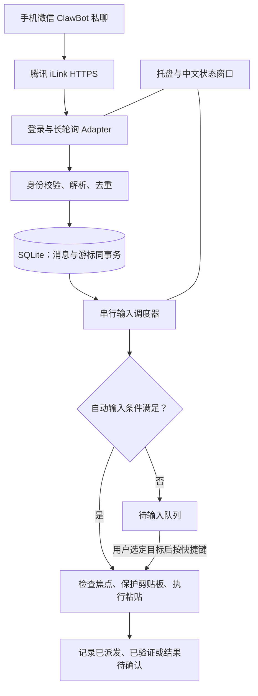

# 微信 → Windows 文本连接器：设计方案

日期：2026-11-07。状态：待确认的规划稿；尚未创建产品工程、安装依赖或进行账号绑定。

## 1. 产品目标与已确认决策

用户在手机微信 ClawBot 会话发送文字，电脑常驻程序接收后，在符合条件时自动写入当前输入框。用户已明确选择“自动输入：符合条件时直接写入当前输入框”。

产品定位为“发完一段，再写入电脑”的远程文本输入器。语音附带现成转写时可以复用同一条通路；完整语音识别另行分期。

本方案建议先做个人使用、单 Windows 用户、单账号、单接收实例。开发位置建议为 `D:\project\01-自研项目\wechat-input-connector`，确认后再创建。

## 2. 首版范围

- 支持 Windows 11 x64 普通权限桌面会话；其他系统与架构后续按实际测试扩展。
- 首次扫码绑定，处理验证码、二维码过期、登录地址重定向；再次运行恢复连接。
- 接收绑定用户的私聊文字；语音存在非空 `voice_item.text` 时直接使用，缺少转写时明确显示“语音暂不可转写”。
- 自动写入经验证的普通文本控件，先记事本，再逐项验收 Chrome 页面输入框、微信聊天编辑区、Word 正文、Cursor 编辑区。
- 系统托盘提供连接状态、暂停/恢复自动输入、待输入队列、重新绑定、设置、退出。
- 全局快捷键 `Ctrl+Alt+V` 逐条插入待输入内容；`Ctrl+Alt+P` 暂停/恢复自动输入，冲突时允许改键。
- 单实例、断线恢复、持久化游标、消息去重、结果状态和简体中文界面。
- 用户无需安装开发环境；先交付自包含便携包，再交付每用户安装包。

首版不包含自建服务器、OpenClaw/AI Agent、手机 App、AI 润色、媒体发送、群聊、多电脑并行消费、远程命令执行、自动更新。暂不下载语音、不装本地 ASR、不接云端 ASR。

“Windows 任意输入框”是方向，不是首版兼容性承诺。管理员窗口、密码框、锁屏/UAC 桌面、终端、浏览器地址栏、自绘且无法判定的控件均停止自动输入。

## 3. 技术核实与原材料修正

截至本次核实，腾讯协议描述了独立实现需要的 HTTPS 接口；文档也明确说明客户端行为不等于完整服务端契约。扫码及持续接收必须实测，不能由公开源码推导出接入永久稳定。[腾讯协议](https://github.com/Tencent/openclaw-weixin/blob/874637a0dbc24050f72d1385add4fc6170a2d726/docs/protocol_zh_CN.md)

需要补入实施范围的细节：

1. `get_bot_qrcode` 为 POST，状态查询为 GET；除普通状态外还包括 `need_verifycode`、`verify_code_blocked`、`scaned_but_redirect`、`binded_redirect`。
2. 请求元数据包括 `iLink-App-Id`、`iLink-App-ClientVersion`、`X-WECHAT-UIN` 等；二维码状态查询与鉴权 POST 的请求头不同。
3. `channel_version` 的 `2.4.8` 是示例，不能视为永久协议版本。记录参考源码提交、实际握手元数据和兼容性测试结果，升级经过回归。
4. `bot_agent` 可用合法 ASCII 自定义标识，建议 `WeChatInputConnector/0.1.0`。它不替代协议所需的应用版本元数据。
5. `getupdates` 是长轮询，默认参考值 35 秒；读取服务端超时建议，设置合理边界和 HTTP 传输余量。正常无消息超时不报断网。
6. `ret` 或 `errcode` 为 `-14` 时进入会话暂停；官方客户端暂停一小时。不得高频重试旧 Token，重新绑定由用户触发。
7. `voice_item.text` 是可选能力，不能把“收到语音”当成“已获得文字”。
8. 腾讯插件包含启动/停止通知接口；P0 核实独立连接是否需要并按兼容行为接入，不先宣称只需两个接口。

第三方 TypeScript 客户端 README 仍描述 GET 获取二维码，与当前腾讯文档存在差异，因此它只作为参考，不直接引入为关键依赖。[第三方项目说明](https://github.com/photon-hq/wechat-ilink-client)

本次参考的腾讯 `main` 提交为 `874637a0dbc24050f72d1385add4fc6170a2d726`。实现时先复核最新变化，再固定采用的提交。若复用源码或文档的重要部分，随发行物保留相应版权与 MIT 许可声明。[腾讯许可证](https://github.com/Tencent/openclaw-weixin/blob/874637a0dbc24050f72d1385add4fc6170a2d726/LICENSE)

## 4. 技术选型：建议 C# 原生桌面方案

推荐 C# + .NET 10 LTS + Windows Forms，采用 `NotifyIcon` 托盘和小型扫码/队列窗口。微信接口用 `HttpClient` / `System.Text.Json`，本地队列用 `Microsoft.Data.Sqlite`，输入调用 Win32/UI Automation，凭据及消息正文使用 Windows DPAPI 当前用户加密。

这是规划建议，并非用户已确认的技术偏好。.NET 10 当前处于 LTS 支持期；具体 SDK 和依赖补丁版本在启动实施时核实并锁定。[支持周期](https://dotnet.microsoft.com/en-us/platform/support/policy/dotnet-core)、[托盘组件](https://learn.microsoft.com/en-us/dotnet/api/system.windows.forms.notifyicon?view=windowsdesktop-10.0)

选择理由：本产品最难的部分集中在 Windows 焦点、权限、剪贴板与发行；C# 可在同一技术栈完成这些工作。与 TypeScript + Node + 原生 FFI 相比，它减少 UI Automation/COM 桥接和原生包适配工作。与 Electron 相比，无需为托盘和两个小窗口引入浏览器界面运行时。该判断是架构取舍，性能仍须实测。

保留两个备选：如果后续明确要复用既有 TypeScript 团队代码，可改用 Node + 原生输入模块；若明确要跨平台，再评估 Tauri。首版不同时维护两套实现。

当前命令行未发现 `dotnet`，本轮未安装 SDK。实施阶段首先确认开发环境；发行使用自包含部署，目标电脑无需预装 .NET。[自包含部署](https://learn.microsoft.com/en-us/dotnet/core/deploying/)

## 5. 架构与职责

模块只保留五个边界：微信协议、可靠收件箱、输入策略、Windows 执行器、桌面外壳。网络接收不能被 UIA 卡顿或输入失败阻塞。Core 只定义规范化事件和服务接口；微信模块把原始批次解析为 `InboxBatch`，Storage 实现 Core 的 `IInboxStore`，Windows 实现 `IFocusProbe` / `ITextWriter`，由 App 装配，Core 和 Storage 均不引用微信 DTO 或 Windows 实现。

UI Automation 探测使用同一发行物的 `--input-helper` 子进程，平时按事件唤醒；同用户受限命名管道通信，辅助进程不读取 Token。探测超时后终止辅助进程并暂停自动输入，避免无限累积卡住的 COM 线程。500 ms 超时针对焦点探测，输入/消费确认另设 2 秒上限；写入阶段超时进入结果待确认及剪贴板恢复流程。它是一个客户端安装包内的隔离单元，不是另装的服务。

## 6. 微信接收与本地可靠性

### 身份和解析

- 绑定身份取扫码成功返回的账号/用户信息；P0 核实其与入站 `from_user_id`、`to_user_id` 的映射。
- 只接收明确匹配绑定用户与 Bot 的私聊、`message_type=1`、已完成消息；不把首次发消息的人自动信任为所有者。
- 身份、完成状态或稳定 ID 缺失时，只记脱敏原因，不自动输入。若真实流量缺少这些字段，P0 未通过，先修订规范再继续。
- 一条消息生成一个文本事件，按 `item_list` 顺序提取顶层文本及现成语音转写，段间用换行分隔；不递归拼入引用消息。
- 图片、文件、视频忽略并显示不支持；语音缺转写记为 `NeedsTranscript`，不伪造识别结果。
- 一次事件最多 10,000 个 UTF-16 代码单元；更长内容保留在队列供人工处理，不静默截断。控制字符仅允许制表和换行；其他字符使事件转人工处理，正文保持原样。

### 入库和游标

去重键采用 `accountId + message_id`，将 ID 无损保存为字符串。不能只对正文做哈希去重，因为连续发送相同文字可能是用户本意。

同一个 SQLite 事务完成：所有消息的解析结果/拒绝原因入库、唯一键去重、非空新游标更新。事务提交成功后才进行输入及下一轮轮询。磁盘满、数据库故障或待处理队列达到 500 条时回滚整个批次，暂停接收并显示原因，不提前推进游标。[SQLite 事务](https://learn.microsoft.com/en-us/dotnet/standard/data/sqlite/transactions)

连接状态：未绑定 → 等待扫码 → 验证中 → 已连接 → 重连中 / 会话暂停。网络错误使用 2、4、8、16、30 秒封顶的退避并加随机抖动，遵循服务端限流指示；无消息长轮询到期立即续订。每账号只允许一个在途请求。重复启动通过当前用户命名互斥锁阻止；其他电脑或 OpenClaw 的并发接管无法靠本地互斥锁排除，首版要求用户只保留一个消费者。

### 状态语义

`Queued → Inserting → Dispatched → Verified`。`Dispatched` 只表示系统已接受输入事件；`Verified` 需要目标控件可读且确实观察到插入结果。无法可靠回读时保留“已派发，未验证”提示，不宣称目标已写入。

派发之后发生焦点变化、部分按键派发、超时或进程崩溃，状态为 `Uncertain`；重启遗留的 `Inserting` 也转为 `Uncertain`。所有这类状态禁止自动重放，由用户查看目标后选择“标记已处理”或“重新排队”。明确未派发的失败才能回到 `Queued`。

本地存储事务无法与其他软件的文本编辑组成同一个事务，因此不承诺崩溃场景下的端到端“恰好一次”。可承诺并验证：稳定运行测试中每条符合条件消息写入一次；异常场景有状态、可恢复、不盲目重试。

## 7. 自动输入规则

每条新消息仅在以下全部条件满足时自动尝试一次：

1. 用户已完成绑定并启用自动输入；会话未锁定、当前为普通交互桌面。
2. 没有待人工处理的旧消息；消息创建时间距当前不超过 15 秒、未来偏差不超过 5 秒。时间缺失或时钟异常均转队列。
3. 目标应用及控件属于已验证兼容范围，控件启用、可编辑、非密码、非只读；密码属性或角色不明确时不写入。
4. 目标窗口权限不高于本程序；目标不是终端、地址栏、系统安全界面或连接器自己的窗口。
5. 焦点指纹（窗口句柄、进程 ID、控件运行时 ID）在探测和派发前一致；没有已知非空选区，避免静默替换已有内容。
6. 修饰键已释放、无正在进行的 IME 组合输入、剪贴板可安全处理。

焦点检查不能原子锁住其他软件，仍有极短竞争窗口；通过写前复核、限制目标、派发后记录异常降低风险。不得宣传为绝不误写。Windows 的权限限制也不能通过普通 `SendInput` 绕过。[SendInput](https://learn.microsoft.com/en-us/windows/win32/api/winuser/nf-winuser-sendinput)、[密码属性](https://learn.microsoft.com/en-us/dotnet/api/system.windows.automation.automationelement.ispasswordproperty?view=windowsdesktop-10.0)

条件不满足时留在队列。解锁、切换焦点、恢复网络、重新启动、从暂停恢复，都不自动补灌积压文字。用户在目标输入框按快捷键，只插入最早的一条 `Queued` 事件；确认仍执行密码、权限、焦点等检查。快捷键的修饰键释放后才派发。

不抢焦点、不自动切换应用、不发送 Enter 或点击“发送”。多行内容以粘贴文本表达，不模拟逐行回车；目标应用如何处理粘贴内容仍需逐项验收。粘贴通常保留目标应用的原生撤销能力，首版不自动调用撤销。

## 8. 剪贴板与输入策略

首版统一使用受保护的剪贴板粘贴，不做失败后自动模拟键盘回退，避免实际已粘贴但误判失败后重复输入。`ValuePattern.SetValue` 不用作通用插入方式，以免替换整个控件内容。

先完整读取可支持的现有剪贴板格式并取得序列号；只在确认仍为该序列号时替换。首版只自动处理空剪贴板及可无损重建的标准纯文本格式集合。遇到图片、文件、HTML/RTF、多种私有格式或延迟渲染对象，保留原剪贴板并转队列，窗口显示“剪贴板包含暂不支持的内容，请先处理后重试”。这是一项明确的首版兼容性限制，不宣称已经支持全部剪贴板格式。

派发 `Ctrl+V` 后，通过目标适配器判断内容已被读取/文本插入；只有可靠确定消费完成、且剪贴板仍由本次操作占有时才恢复快照。序列号已变代表用户或其他程序写入新内容，禁止恢复旧内容。无法确认消费时停止后续自动输入并提示当前剪贴板状态；不凭固定延时宣称恢复安全。[剪贴板序列号](https://learn.microsoft.com/en-us/windows/win32/api/winuser/nf-winuser-getclipboardsequencenumber)

快照归主进程管理：辅助进程读取受支持快照后，先由主进程用 DPAPI 持久化恢复记录并确认，才允许替换剪贴板；替换后的序列号也在派发前持久化。记录包括事件 ID、原内容密文、已知序列号、所处阶段和暂停标记。辅助进程卡住、被终止或主进程崩溃后，重启只展示遗留记录并保持自动输入暂停，不自动恢复旧剪贴板。序列号缺失或发生变化均不得猜测归属；用户查看目标与当前剪贴板后，可明确选择保留当前内容并清除恢复记录，或在再次核验后手动恢复快照。

剪贴板结果区分 `Untouched`、`Restored`、`UserChanged`、`PendingRecovery`，不使用一个布尔值混淆状态。恢复记录的清理必须与事件处理结果协调；未解决的 `PendingRecovery` 不允许通过普通“恢复自动输入”开关跳过。

P0 必须验证这一策略的可用性；若多数目标无法可靠确认消费，先缩小兼容范围或改为经验证的应用专属写入方式，不能把猜测式延时恢复带入首版。

## 9. 存储、隐私与轻量运行

- 配置和数据位于 `%LOCALAPPDATA%\WeChatInputConnector`；配置 JSON 不含 Token。
- Token、游标和待输入正文使用 DPAPI `CurrentUser` 保护；数据库/WAL/诊断不写入这些内容的明文。DPAPI 面向当前 Windows 用户保护，不隔离同用户恶意程序。[DPAPI](https://learn.microsoft.com/en-us/dotnet/api/system.security.cryptography.protecteddata?view=windowsdesktop-10.0)
- 正文处理完成后清空密文载荷；待处理正文默认最多保留 24 小时，过期变为 `Expired`。剪贴板恢复快照同样最多保留 24 小时；到期删除原内容，仅保留“快照已过期、需人工确认”的暂停状态，不能自动解除。去重元数据保留 7 天；更早历史消息仍受自动输入时间窗约束。
- 日志仅含脱敏事件键、状态、错误类型和耗时，滚动上限 10 MB；不记正文、完整游标、二维码参数、Token 或媒体密钥。
- 首次绑定完成后明确显示自动输入已启用；开机启动默认关闭，用户可自行开启。自动输入开关持久化，重启只处理新的合格消息。
- 网络仅主动访问微信接口；登录返回地址只接受 HTTPS 和经过 P0 核实的微信域名范围，拒绝凭据转发到未核实域名。不开放本地 HTTP 端口。
- 无消息时不截图、不录音、不扫描完整桌面树、不持续轮询焦点。焦点检查仅由新事件或手动插入触发，默认超时 500 ms。
- 暂定性能验收目标：稳定空闲 10 分钟，主程序与辅助进程合计平均 CPU ≤ 0.5%、私有内存 ≤ 120 MB；事件入库至派发 p95 ≤ 500 ms。均为目标，须记录硬件、系统、版本及实测值，未达标时先定位。

## 10. 阶段与退出条件

### P0：技术可行性验证，预计 1–2 人日

只在测试账号和记事本测试文本上操作。完成真实扫码、连续长轮询、身份字段映射、断网重连、文字粘贴、剪贴板保护和权限判断。收集 30 条不同长度的真实语音，只记录是否附带转写及耗时，不保留原音频。

通过条件：扫码可独立完成；100 条带唯一序号的文本逐条核对无漏写、重复写入或乱序；记录实际协议元数据；断网后恢复游标；输入路径可证明消费完成或明确收窄支持范围。关键条件失败即停止下一阶段，更新方案。

### P1：可日常试用的文字版，预计再投入 3–6 人日

实现可靠收件箱、自动输入策略、托盘、队列、快捷键、安全存储和错误状态。语音有现成转写即使用；无转写时清晰提示。先交付自包含便携包。

通过条件：记事本链路复测通过；重复批次、写盘失败、派发后崩溃、锁屏/解锁、焦点变化、密码框、剪贴板竞争均有预期记录；暂缓事件不会突然补写。

### P2：兼容性与安装交付，预计再投入 2–4 人日

在实机逐控件验证 Chrome 页面输入区、微信编辑区、Word 正文、Cursor 编辑区，记录准确应用版本。不通过的控件显示暂不支持。完成普通用户安装/卸载、可选自启动、运行性能和至少 8 小时在线测试。

交付 EXE 便携包及每用户安装程序、兼容清单、测试记录、第三方许可。安装器建议 Inno Setup，具体版本和使用条件在实施时核实。公开分发的代码签名需要用户具备证书，不能把未签名内部测试包当成已完成公开发行。

P0–P2 合计预计 6–12 人日，为单人开发与调试估算，不含服务接入等待、证书办理、不可控协议变化或后续 ASR。阶段评审后重估，不能视为交付日期承诺。

### P3：完整语音能力，另行立项

依据 30 条语音的转写覆盖率决定是否需要下载/解密/解码与 ASR。选择本地方案前实测内存与 CPU；选择云端方案前明确音频传输和费用。无论样本覆盖率多高，都不把可选转写字段当作永久保证。

## 11. 最终验收与规划待确认项

交付验收以“目标应用实际出现了什么文字”为准，不能仅看请求成功、日志成功或 `SendInput` 返回非零。每条测试记录要能对上源序号、接收事件、派发状态和目标内容；延迟分别统计微信到达与本地派发，语音录制时长不混入处理时延。

实施前需确认本稿中的建议：C#/.NET 技术栈、Windows 11 x64 首批范围、纯文本剪贴板限制、6–12 人日估算。本轮确认自动模式已经完成；无需再次询问。

本目录是规划输出位置，当前不是 Git 仓库。本轮不初始化 Git、不提交、不创建产品代码；确认实施后再建立独立工程和版本管理。配套实施清单位于 `../plans/2026-11-07-wechat-input-connector.md`。
