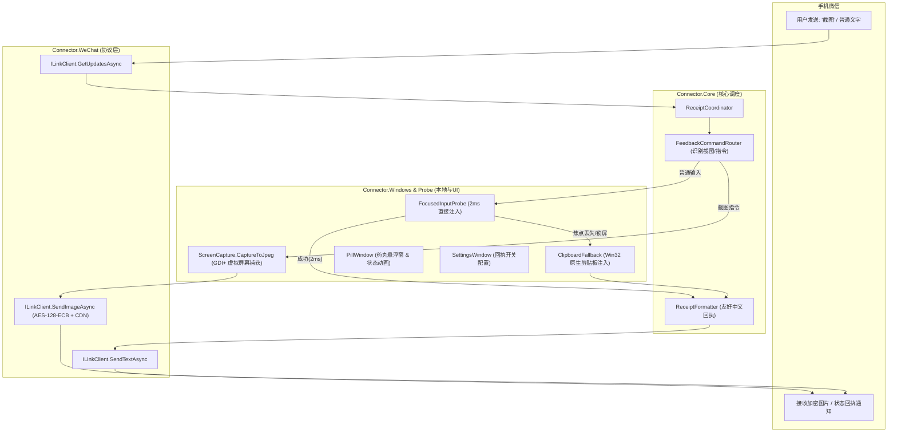

# 双向反馈与远程屏幕截图设计方案 (Feedback & Screenshot Design)

> **目标：** 解决电脑锁屏或光标丢失时无法通讯的痛点，提供输入保底（自动复制到剪贴板）与状态回执反馈，并支持从手机微信发送“看屏幕 / 截图”指令，远程获取电脑桌面高清截图回传微信。

---

## 1. 背景与核心问题

1. **光标丢失与锁屏痛点**：
   - 当用户在手机微信发送文字时，如果电脑当前锁屏（Winlogon / UAC 隔离桌面）、处于待机、或者用户鼠标焦点未处于任何可编辑输入框中，连接器会拒绝注入并进入 `Queued` 状态。
   - 此时手机端无法得知具体原因，电脑端也未将文字存入剪贴板，导致通讯“断联”，用户必须重新打开微信手动复制。
2. **缺乏远程感知能力**：
   - 用户在移动端往往想确认电脑当前正在运行什么软件、是否有弹窗、或者当前窗口状态。
   - 需要一种零复杂度、无需引入外部重量级 AI Agent 的轻量反馈方案：发送关键词（“截图”、“截屏”、“看屏幕”）即可自动捕获 Windows 当前屏幕画面并加密回传手机微信。

---

## 2. 系统架构与分层设计

整个方案严格保持现有 2ms Direct Injection 性能基线与模块清晰解耦：

---

## 3. 详细协议与模块设计

### 3.1 微信 iLink 媒体上传协议 (`ILinkClient.SendImageAsync`)

微信 iLink Bot 的图片发送遵循严格的安全与加密流程：
1. **原始数据准备**：
   - 捕获桌面得到 JPEG 字节数组 `rawBytes`。
   - 计算原始大小 `rawsize = rawBytes.Length`。
   - 计算小写 32 位 MD5 哈希：`rawfilemd5 = Convert.ToHexStringLower(MD5.HashData(rawBytes))`。
2. **AES-128-ECB 加密**：
   - 生成 16 字节随机密钥 `aesKey = RandomNumberGenerator.GetBytes(16)`。
   - 密钥格式化：小写十六进制 `aesKeyHex`（32 字符）以及 Base64 编码 `aesKeyBase64`。
   - 使用 AES-128-ECB 与 PKCS#7 填充模式加密 `rawBytes` 得到 `encryptedBytes`，计算密文长度 `filesize = encryptedBytes.Length`。
3. **申请上传 URL (`POST /ilink/bot/getuploadurl`)**：
   - 请求体包含 `filekey`（32 字符随机十六进制/GUID）、`media_type = 1`、`to_user_id`、`rawsize`、`rawfilemd5`、`filesize`、`base_info`。
   - 解析返回的 JSON，提取 `upload_full_url`。
4. **CDN 密文上传**：
   - 向 `upload_full_url` 发送 HTTP POST，`Content-Type: application/octet-stream`，Body 为密文字节。
   - 从 HTTP 响应标头中提取 `x-encrypted-param`（不区分大小写）。
5. **发送图片消息 (`POST /ilink/bot/sendmessage`)**：
   - 构造 `image_item`，包含 `filekey`、`aeskey = aesKeyHex`、`media: { encrypt_query_param, aes_key: aesKeyBase64 }`、`mid_size = rawsize`、`hd_size = rawsize`。
   - 消息通过现有 Bearer Token 验证送达。

### 3.2 桌面截屏引擎 (`ScreenCapture.cs`)

- 位于 `Connector.Windows`。
- 使用 `System.Drawing` 与 Windows GDI 捕获全屏：
  - 自动覆盖多显示器虚拟屏幕：`SystemInformation.VirtualScreen`。
  - 采用标准高质量 JPEG 编码（质量 75-80），兼顾清晰度与手机网络加载速度（通常大小在 250KB - 500KB 之间）。
  - 安全锁屏检测：若当前桌面为 Winlogon/锁屏且无权限读取像素，捕获安全占位提示图或友好说明。

### 3.3 焦点丢失与锁屏保底机制 (`ClipboardFallback`)

- 当 `FocusedInputProbe.InsertAsync` 返回 `Queued`（原因通常为“请先点入要写入的输入框”、“当前控件不可用”或锁屏桌面隔离）时：
  1. **Win32 原生剪贴板注入**：
     - 使用 `OpenClipboard` / `EmptyClipboard` / `SetClipboardData(CF_UNICODETEXT)`，不依赖 STA 线程，避免 COM/OLE 初始化冲突与死锁。
     - 若剪贴板被其他应用临时占用，进行 5 次指数退避重试（间隔 20ms）。
     - 将文字完整存入剪贴板，状态标记为 `Copied`。
  2. **双向状态回执发送**：
     - 若设置中开启 `FeedbackReplies`，回发微信：
       `"⚠️ 电脑当前无焦点或处于锁屏状态（文字已自动存入电脑剪贴板）。解锁后按 Ctrl+V 直接粘贴。\n编号：<id>"`
  3. **Pill 悬浮窗反馈**：
     - 悬浮窗展开显示：“⚠️ 未对准输入框（已存剪贴板并通知微信）”，黄色状态点，并在 3 秒后优雅缩回迷你光珠。

### 3.4 截图指令路由 (`FeedbackCommandRouter`)

- 关键词匹配规则：
  - 完整匹配（忽略前后空白）：`"截图"`、`"截屏"`、`"看屏幕"`、`"屏幕"`、`"/截图"`、`"/截屏"`、`"/屏幕"`。
  - 匹配成功后，跳过键盘注入流程，立即异步执行截屏并发送图片回传微信。
  - 成功后回执/悬浮窗显示：“📸 已截屏并回传微信”。

### 3.5 设置与手动触发集成

- **`SettingsWindow`**：
  - 新增设置项：`FeedbackReplies`（微信状态回执与反馈消息），默认开启。用户可自由切换静默打字或主动反馈模式。
- **`PillWindow` 托盘 / 右键菜单**：
  - 新增右键菜单项：“📸 截取屏幕发微信”。点击后立即截屏并利用最近有效的微信会话上下文发送回执。

---

## 4. 关键指标与非功能要求

1. **响应速度**：
   - 截屏与编码在现代 PC 上通常小于 50ms。
   - 上传过程异步执行，绝不阻塞微信长轮询主循环。
2. **安全性与隐私**：
   - 图片在内存中直接使用 AES-128-ECB 加密后上传腾讯微信官方 CDN，传输全程密文。
   - 剪贴板写入仅限用户自身发送的文字，不记录系统原本的剪贴板历史，不向外部泄露。
3. **兼容性**：
   - 保证现有 122 个单元测试（Connector.Tests: 86, Connector.Windows.Tests: 36）100% 保持通过。
